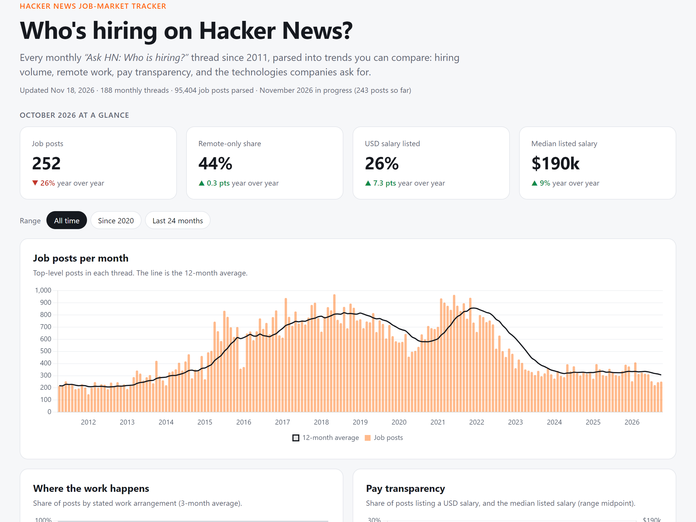

# Who's hiring on Hacker News?

A self-updating dashboard of the tech job market, built from every monthly
*“Ask HN: Who is hiring?”* thread since April 2011 (95,000+ job posts).

**Live:** https://za1815.github.io/hn-hiring-trends/



## What it shows

- **Hiring volume:** job posts per month, with a 12-month average (the 2021–22 boom and the 2023 drop are easy to spot).
- **Work arrangement:** remote-only, hybrid, and on-site shares over time.
- **Pay transparency:** share of posts listing a USD salary, and the median listed salary.
- **Technology demand:** mention share for 41 technologies, with a rising-and-falling table for the last 12 months.

## How it works

```
Algolia HN API ──► fetch.py ──► parse.py + taxonomy.py ──► build.py ──► site/data/summary.json ──► static dashboard
 (threads, posts)   cache,       classify each post          monthly        (committed)              (Chart.js, GitHub Pages)
                    retries      (tech, remote, salary)      aggregates
```

- **Pipeline (Python, standard library only).** `pipeline/fetch.py` finds every monthly thread, including a few early months posted by community members instead of the `whoishiring` bot, and caches posts locally. `pipeline/parse.py` cleans the HTML and classifies each post; `pipeline/build.py` aggregates months and writes one compact JSON file.
- **Classification is tested.** Salary parsing handles `$120k–$180k`, `$120,000 to $165,000`, `$140-190k`, `150k-200k USD` and single figures, and rejects hourly, monthly, funding and bonus amounts. Ambiguous technology names (`Go`, `React`, `Node`, `.NET`) are matched with case rules and exclusions. See `tests/test_parse.py`.
- **Incremental and scheduled.** A daily GitHub Actions job runs the tests, refreshes the two most recent threads, commits the new summary, and redeploys the site. `workflow_dispatch` with `full` rebuilds all months after a taxonomy change.
- **No backend.** The dashboard is static HTML and JavaScript reading one JSON file, so hosting is free and the page loads fast.

## Run it locally

```bash
python -m venv .venv && . .venv/bin/activate   # Windows: .venv\Scripts\activate
pip install pytest
pytest -q                                      # parser tests
python -m pipeline.build --full                # first run downloads ~190 threads (about 2 minutes)
python -m http.server -d site 8000             # open http://localhost:8000
```

## Caveats

Hacker News posts skew toward startups and US tech companies, so this tracks that slice of the market, not all hiring. Keyword matching counts mentions, not requirements. Before mid-2015 the thread format did not ask for location, so early work-arrangement data is mostly “not stated”.

---

Built by Zaid A. I build data pipelines, scrapers, automations and dashboards like this one. [Hire me on Upwork](https://www.upwork.com/freelancers/~01d3019334f06de3cc).
